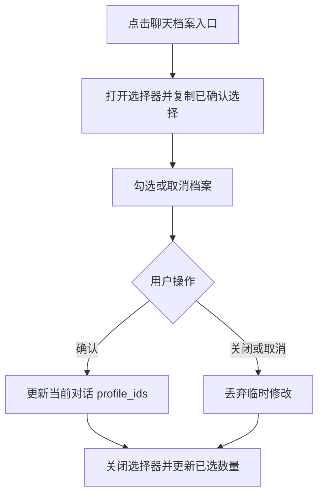
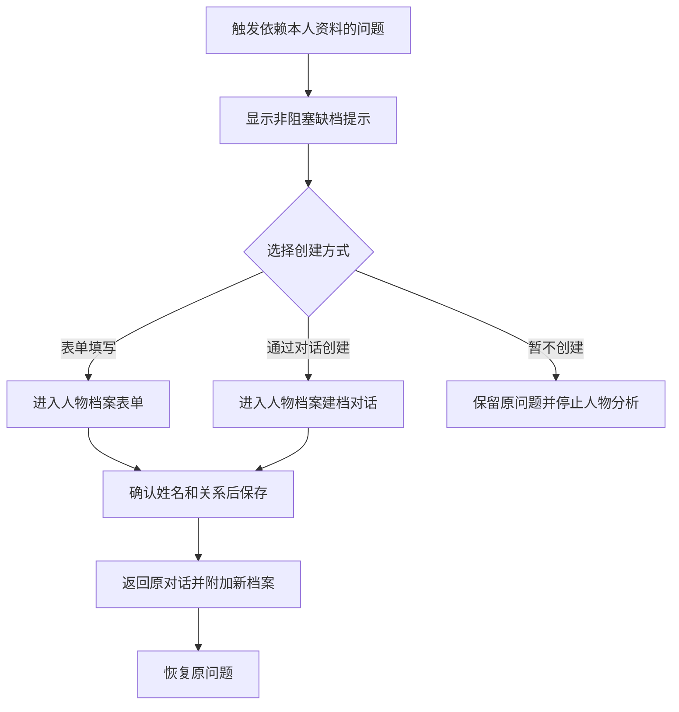
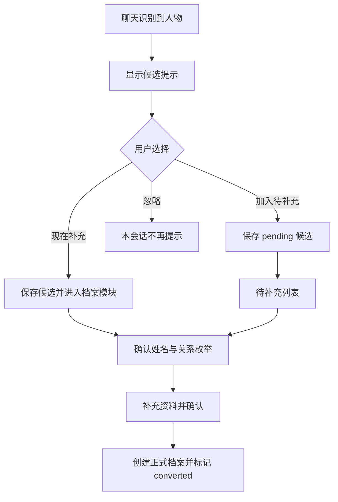

# 人物档案模块产品与 UI 设计

> 版本：v1.0
> 状态：开发中
> 关联需求：`docs/vibe_coding/人物档案模块需求/需求.md`
> 适用范围：`apps/web` 桌面端与手机端
> 设计系统：沿用 Ant Design 5、Ant Design X 与现有问甲主题

## 1. 设计结论

人物档案采用两个职责明确的界面：

1. **聊天档案选择器**：只决定本轮对话使用哪些已有档案，不提供任何管理操作。
2. **独立人物档案模块**：负责新增、编辑、删除、恢复、待补充处理和文本复制。

整体是个人工作台，不采用营销式大标题、卡片墙或装饰性动效。设计保持现有白底、深青主色、紧凑行列表和低阴影语言。

设计参数：

| 参数 | 值 | 说明 |
| --- | --- | --- |
| `DESIGN_VARIANCE` | 3 | 布局稳定、易预测，不做实验性排版 |
| `MOTION_INTENSITY` | 2 | 仅使用状态切换、抽屉和反馈动效 |
| `VISUAL_DENSITY` | 7 | 支持重复查看与维护多个人物档案 |

## 2. 设计目标

- 用户在聊天中能快速选择人物，不会误触编辑或离开当前问题。
- 用户在独立模块中能清楚理解本人档案、其他人物、待补充人物和回收站之间的区别。
- 新增档案时，姓名和与本人关系成为最先确认的字段。
- 对话识别结果始终表现为建议，不让用户误以为系统已经保存档案。
- 桌面端和手机端使用相同概念、名称和状态，仅根据屏幕宽度调整承载方式。
- 现有聊天布局、会话侧栏和主品牌视觉保持稳定。

## 3. 现状审视

当前 `ProfilePanel` 同时承担选择、新增、编辑、删除和回收站，导致以下问题：

- 聊天中的高频选择被低频管理操作干扰。
- 档案条目同时具备整行选择、编辑和删除点击目标，触控与键盘行为复杂。
- 手机端弹层空间有限，表单、回收站和选择列表容易形成多层弹窗。
- 用户很难判断点击档案是在“用于本轮对话”还是“进入管理”。

本次保留现有聊天输入区的档案入口，但将管理能力完整迁移到独立模块。

## 4. 信息架构

```text
问甲工作台
├── 对话
│   ├── 聊天内容
│   ├── 档案选择器
│   │   ├── 选择或取消选择
│   │   ├── 清空
│   │   └── 确认
│   └── 候选人物提示
└── 人物档案
    ├── 概览
    ├── 我的档案
    ├── 待补充
    ├── 回收站
    ├── 新增档案
    ├── 编辑档案
    └── 对话式建档
```

### 4.1 桌面端入口

- 聊天输入区左侧保留“档案”按钮，点击打开聊天档案选择弹层。
- 工作台左侧主导航新增“人物档案”项，位于“长期记忆”附近，使用 `ContactsOutlined` 或项目当前图标库中语义最接近的人物档案图标。
- “人物档案”可显示待补充数量 Badge。Badge 只显示未处理数量，最大显示 `99+`。
- 侧栏折叠时仅显示图标与 Badge，悬停 Tooltip 为“人物档案”。

### 4.2 手机端入口

- 聊天输入区工具栏保留档案图标，点击打开底部选择抽屉。
- 左侧导航抽屉或账号菜单中新增“人物档案”入口，进入全屏管理模块。
- 聊天选择抽屉内不出现“管理档案”“新增档案”或编辑图标。

## 5. 页面框架

### 5.1 桌面端人物档案模块

独立模块沿用当前工作台左侧主导航，主内容区使用固定页面头和滚动内容。

```text
┌──────────────┬──────────────────────────────────────────────┐
│ 工作台导航   │ 人物档案                              [+]   │ 64
│              ├──────────────────────────────────────────────┤
│ 对话列表     │ 本人档案状态  有效档案  待补充              │
│              │                                              │
│              │ [我的档案] [待补充 2] [回收站]              │
│ 人物档案     │ ──────────────────────────────────────────── │
│ 长期记忆     │ 姓名 / 关系 / 出生信息 / 排盘状态 / 操作     │
│              │ 姓名 / 关系 / 出生信息 / 排盘状态 / 操作     │
│              │ 姓名 / 关系 / 出生信息 / 排盘状态 / 操作     │
└──────────────┴──────────────────────────────────────────────┘
```

布局规格：

| 项目 | 规格 |
| --- | --- |
| 左侧主导航 | 沿用现有展开 `288px`、折叠 `58px` |
| 页面头 | 高 `64px`，左右内边距 `24px`，底部 1px 分隔线 |
| 内容宽度 | `min(1040px, 100%)`，居中或左对齐于主内容栅格 |
| 内容边距 | 桌面 `24px`，窄桌面 `20px` |
| 页面标题 | `24px / 32px`，字重 700 |
| 区块标题 | `16px / 24px`，字重 700 |

页面不使用大面积悬浮卡片。概览使用同一平面上的三组关键数据，以垂直分隔线区分；列表使用行分隔和轻量悬停背景。

### 5.2 手机端人物档案模块

```text
┌──────────────────────────┐
│ ‹  人物档案          [+] │ 56 + safe-top
├──────────────────────────┤
│ 本人档案：待创建          │
│ 有效 3 人   待补充 2      │
├──────────────────────────┤
│ [我的档案] [待补充 2] [回收站] │
├──────────────────────────┤
│ 张三  本人                │
│ 1995-05-12 09:30    [⋯]  │
├──────────────────────────┤
│ 李四  母亲                │
│ 出生时间待补充      [⋯]  │
└──────────────────────────┘
```

- 页面占满 `100dvh`，不放在通用 Modal 中。
- 顶栏固定，列表区域独立滚动。
- 页签位于概览下方并在滚动后吸顶。
- 新增使用顶栏加号图标按钮，触控区 `44px`，`aria-label="新增人物档案"`。
- 表单、详情和对话式建档均作为下一层全屏页面打开，返回后恢复列表页签、筛选和滚动位置。

## 6. 聊天档案选择器

### 6.1 共同规则

- 只显示当前账号的有效正式档案。
- 不显示待补充人物和已删除档案。
- 最多选择 8 人，达到上限后未选条目置为禁用，并提示“每轮最多选择 8 人”。
- 打开时使用当前会话已确认的选择创建临时副本。
- 点击条目只修改临时选择。
- 点击“确认”后提交临时选择并关闭。
- 点击遮罩、关闭、`Esc` 或系统返回时放弃临时修改，保留上次已确认选择。
- 无新增、编辑、删除、恢复、复制和管理跳转入口。

### 6.2 桌面端弹层

```text
┌────────────────────────────────┐
│ 选择本轮人物              2/8 │ 52
├────────────────────────────────┤
│ [✓] 张三  [本人]              │
│     1995-05-12 09:30 · 已排盘 │ 56
│ [ ] 李四  [母亲]              │
│     出生时间待补充            │ 56
│ [✓] 王五  [朋友]              │
│     1994-11-03 · 已排盘       │ 56
├────────────────────────────────┤
│ 清空                      确认 │ 56
└────────────────────────────────┘
```

| 项目 | 规格 |
| --- | --- |
| 承载组件 | Ant Design `Popover` 或非模态浮层 |
| 宽度 | `360px`，小屏桌面最小 `320px` |
| 最大高度 | `min(520px, 60dvh)` |
| 锚点 | 聊天输入区档案按钮上方，优先 `topLeft` |
| 圆角 | `10px` |
| 阴影 | 仅浮层使用现有中等阴影 |
| 列表滚动 | 仅中间列表滚动，头尾固定 |

档案行结构：

- 左侧 `Checkbox`，点击整行等同切换 Checkbox。
- 第一行显示姓名与关系 Tag；姓名使用 `14px`、字重 600。
- 第二行显示压缩出生信息和排盘状态，使用 `12px` 次要色。
- 选中状态采用浅青背景和青色边框，不使用明显位移或大阴影。
- 键盘支持 `Tab` 聚焦、空格切换、`Enter` 确认、`Esc` 关闭。

空状态只显示图标和“暂无可选档案”。按照需求，不放新增按钮和管理入口。

### 6.3 手机端底部抽屉

```text
┌──────────────────────────┐
│          拖动条          │
│ 选择本轮人物         2/8 │
├──────────────────────────┤
│ [✓] 张三  本人           │
│     1995-05-12 · 已排盘  │
│ [ ] 李四  母亲           │
│     出生时间待补充       │
│                          │
├──────────────────────────┤
│ 清空             确认(2) │
└──────────────────────────┘
```

| 项目 | 规格 |
| --- | --- |
| 承载组件 | Ant Design `Drawer`，`placement="bottom"` |
| 高度 | 内容自适应，最大 `70dvh` |
| 顶部圆角 | `10px 10px 0 0` |
| 安全区 | 底部操作区加 `env(safe-area-inset-bottom)` |
| 条目高度 | 最小 `60px` |
| 触控目标 | 不小于 `44 x 44px` |

软键盘打开时，抽屉不应被输入法遮挡。选择器打开后可主动让聊天输入框失焦，避免抽屉与键盘同时占用屏幕。

## 7. 人物档案首页

### 7.1 页面头

- 标题：“人物档案”。
- 桌面主操作：带加号图标的“新增人物”按钮。
- 手机主操作：仅加号图标，Tooltip 或长按说明为“新增人物”。
- 页面头不展示功能说明长文。

### 7.2 概览区

三项数据在同一水平带中展示：

| 指标 | 展示 | 点击行为 |
| --- | --- | --- |
| 本人档案 | `已建立`、`待完善` 或 `未建立` | 切换到本人档案详情或打开创建方式选择 |
| 有效档案 | 人数 | 切换到“我的档案” |
| 待补充 | 未处理人数 | 切换到“待补充” |

本人未建立时，概览下显示浅青提示带：

```text
建立本人档案后，提问时可直接选择，无需重复填写出生资料。
[表单填写] [通过对话创建]                         [暂不创建]
```

提示带为页面内状态区，不是弹窗。关闭后本次访问不重复出现。

### 7.3 页签

使用 `Tabs`：

- 我的档案
- 待补充，存在数据时显示数量 Badge
- 回收站

桌面端页签靠左；手机端等宽分布。切换页签不刷新整页，浏览器前进/后退应能恢复页签状态。

## 8. 我的档案列表

### 8.1 档案行

桌面端使用紧凑列表行，不使用独立大卡片：

```text
张三  [本人]         1995-05-12 09:30 北京市     已排盘     [复制] [编辑] [⋯]
李四  [母亲]         1968-03-21 出生时间待补充    待完善     [复制] [编辑] [⋯]
```

| 区域 | 内容 |
| --- | --- |
| 主标识 | 姓名、关系 Tag；本人关系固定排在列表首位 |
| 出生信息 | 历法、日期、时间、出生地的压缩摘要 |
| 状态 | `已排盘`、`待排盘`、`待完善` |
| 快捷操作 | P1 提供复制；P0 提供编辑；更多菜单包含移入回收站 |

行高：桌面最小 `64px`，手机最小 `72px`。列表按本人优先、更新时间倒序排列。

关系 Tag 使用金色系作为分类信息；状态使用语义色：

- 已排盘：青色文字或浅青 Tag。
- 待完善：金色文字或浅金 Tag。
- 数据错误：红色，仅用于确实需要处理的异常。

### 8.2 搜索与筛选

P0 档案少于 10 条时不显示搜索。达到 10 条后显示按姓名搜索，避免初始页面过度拥挤。

P1 支持按关系、资料状态、分组和标签筛选。手机端筛选进入单独底部抽屉，筛选结果数量实时展示。

### 8.3 行操作

- “编辑”使用 `EditOutlined` 图标和文字，桌面可直接展示。
- “移入回收站”放入 `MoreOutlined` 菜单，使用 `DeleteOutlined` 和危险色。
- 删除必须二次确认，文案说明“历史对话仍保留当时的档案名称，但后续不会再使用该档案”。
- 手机端所有次要操作收纳到更多菜单，避免一行出现多个窄按钮。

## 9. 新增与编辑

### 9.1 创建方式选择

点击新增后进入轻量方式选择页或对话框：

| 方式 | 标题 | 说明 | 图标 |
| --- | --- | --- | --- |
| 表单填写 | 表单填写 | 直接录入姓名、关系和出生资料 | `FormOutlined` |
| 通过对话创建 | 通过对话创建 | 系统按缺失项目逐项询问并在确认后保存 | `MessageOutlined` |

两项同级，不设置默认选中。手机端使用两个全宽列表选项，不使用左右并排卡片。

### 9.2 表单页面

表单分为三个连续区块，不在卡片中嵌套卡片：

1. 基础信息
2. 出生信息
3. 出生地

桌面布局：

```text
基础信息
姓名 *                   与本人关系 *
[________________]       [____________]
性别
[男] [女] [未知]

出生信息
历法                     闰月（仅农历）
[公历 | 农历]            [非闰月 | 闰月]
出生日期                 出生时间
[年 / 月 / 日]           [时 / 分]

出生地
省市                     经度（高级信息）
[省 / 市]                [自动获取或手动值]
```

关键规则：

- 姓名是第一个字段，创建时自动聚焦。
- 关系是第二个必填字段，只能选择固定枚举。
- 选择“其他”后在关系字段下方显示“关系说明”必填输入框。
- 本人、父亲、母亲、伴侣、子女、朋友的别称只用于展示说明，提交值仍为固定枚举。
- 出生资料允许暂缺，保存按钮仍可用；保存前提示“资料尚不完整，暂不能排盘”。
- 编辑出生资料时，如果会使旧命盘失效，在保存确认中明确列出受影响字段。

### 9.3 表单操作区

- 桌面端底部右侧：取消、保存。
- 手机端底部固定：取消为次要文本按钮，保存为主按钮；操作区避开安全区。
- 保存中按钮显示加载并禁止重复提交。
- 字段错误就近展示，网络错误在操作区上方展示可重试提示。
- 登录过期后保留本地表单草稿，重新登录成功后恢复。

### 9.4 对话式建档

对话式建档属于人物档案模块，不复用普通聊天选择器。

顶部固定显示当前建档对象：

```text
正在创建：新人物
已确认 0/2：姓名、与本人关系
```

收集顺序：

1. 姓名
2. 与本人关系确认
3. 性别
4. 历法和出生日期
5. 出生时间
6. 出生地
7. 信息摘要确认
8. 排盘并保存

姓名未输入时只询问姓名。关系未确认时只处理关系确认，不能进入排盘。关系识别可给出建议，例如“我理解为‘母亲’，是否确认？”，确认后才映射到 `母亲` 枚举。

## 10. 待补充人物

### 10.1 聊天内提示

候选提示放在相关助手消息下方，视觉上属于消息的后续操作，不另起模态弹窗：

```text
检测到你提到了“母亲”，是否将她加入待补充人物？
[加入待补充] [现在补充] [忽略]
```

- 使用浅金边框或左侧提示线，表示“待确认”，不得使用成功色。
- “加入待补充”为主操作，“现在补充”为次要操作，“忽略”为文本操作。
- 关闭或忽略后，原位置显示低强调文本“已忽略”，不再重复弹出。
- 同一条消息最多展示 3 个候选，更多内容合并为“另有 N 位待确认”。

### 10.2 待补充列表

```text
我的母亲  [关系建议：母亲]     来源：基础命盘分析 · 2小时前
尚未保存为正式档案             [补充资料] [通过对话补充] [忽略]
```

- 明确显示“尚未保存为正式档案”。
- 关系建议使用虚线边框 Tag，与正式关系 Tag 区分。
- P0 默认按最近提及时间倒序。
- 编辑或补充时，关系建议必须由用户再次确认才能写入正式枚举。
- 忽略使用 `Popconfirm` 或确认对话框，避免误触。

## 11. 回收站

- 以列表行显示姓名、关系和删除时间。
- 唯一主要操作是“恢复”。
- 恢复本人档案发生冲突时，在当前行展示错误，并提供“查看现有本人档案”操作。
- 回收站不展示候选人物，也不提供复制档案文本。
- 空状态为“回收站为空”，不提供新增入口。

## 12. 文本复制（P1）

复制入口位于有效档案的行操作和详情页操作区。点击后默认直接复制，不打开复杂配置；若档案有备注，则先打开轻量确认：

```text
复制档案文本
[ ] 包含备注

[取消] [复制]
```

纯文本格式：

```text
姓名：张三
与本人关系：本人
性别：男
出生日期：1995年5月12日
出生时间：09:30
历法：公历
出生地：北京市
四柱：乙亥 辛巳 癸卯 丁巳
五行：木2、火2、土0、金1、水3
档案状态：已排盘
```

未填写字段显示“未填写”。不得复制内部 ID、来源会话、时间戳、长期记忆、完整对话或内部计算 JSON。

复制成功使用短 Toast“档案文本已复制”。剪贴板失败时打开只读 `TextArea` 预览并自动全选，允许手动复制。

## 13. 状态设计

| 界面 | 加载 | 空状态 | 错误 | 成功反馈 |
| --- | --- | --- | --- | --- |
| 聊天选择器 | 3 行匹配高度的 Skeleton | 暂无可选档案 | 内联“档案加载失败”与重试图标 | 确认后关闭，按钮数量更新 |
| 我的档案 | 列表行 Skeleton | 还没有人物档案，显示创建入口 | 页面级错误带与重试 | 新增后 Toast 并定位新行 |
| 待补充 | 列表行 Skeleton | 暂无待补充人物 | 页面级错误带与重试 | 转正后从列表移除并 Toast |
| 回收站 | 列表行 Skeleton | 回收站为空 | 页面级错误带与重试 | 恢复后从列表移除并 Toast |
| 表单 | 编辑时先加载字段 | 不适用 | 字段内联错误、提交错误带 | 保存后返回列表并 Toast |
| 对话式建档 | 消息占位与状态文字 | 不适用 | 保留已输入内容并允许重试 | 保存后进入档案详情摘要 |

禁止仅使用全局 Spin 代替列表结构加载。Skeleton 尺寸必须与最终内容一致，避免布局跳动。

## 14. 视觉规范

### 14.1 颜色

沿用现有变量，不新增第二套主色：

| 语义 | 色值 | 用途 |
| --- | --- | --- |
| 主色 | `#0f766e` | 主按钮、选中、焦点、已排盘 |
| 主色深 | `#115e59` | 链接、强调文字 |
| 待确认 | `#b45309` | 关系 Tag、候选、待完善 |
| 危险 | `#b91c1c` | 删除、错误 |
| 正文 | `#1f2a2e` | 标题和正文 |
| 次要文字 | `#6b7280` | 辅助信息 |
| 页面底色 | `#f7f8f8` | 工作区背景 |
| 表面 | `#ffffff` | 列表、浮层、表单 |
| 分隔线 | `#e5e7eb` | 边界和行分隔 |

青色只表达主操作、选择和成功状态；金色只表达分类、待确认和待完善；红色只表达错误或危险操作。

### 14.2 字体与层级

沿用当前字体栈：`Inter, PingFang SC, Microsoft YaHei, system-ui, sans-serif`。

| 角色 | 字号 / 行高 | 字重 |
| --- | --- | --- |
| 页面标题 | `24 / 32px` | 700 |
| 移动端页面标题 | `18 / 26px` | 700 |
| 区块标题 | `16 / 24px` | 700 |
| 姓名 | `14 / 22px` | 600 |
| 正文 | `14 / 22px` | 400 |
| 辅助信息 | `12 / 18px` | 400 |

所有字间距为 0，不使用全大写英文微标签。

### 14.3 圆角、边框和阴影

- 页面、列表区不做浮动卡片。
- 输入框、按钮、Tag：`7px` 或 Ant Design 对应小圆角。
- 浮层、抽屉顶部、确认框：`10px`。
- 列表行默认无外阴影，只在悬停时使用轻背景变化。
- 中等阴影只用于 Popover、Drawer 和 Modal。

### 14.4 动效

- Popover、Drawer：`180ms ease-out`。
- 行背景、边框、选中：`120ms ease`。
- 按钮按下：最多 `scale(0.98)` 或 `translateY(1px)`。
- 不使用循环动画、装饰动画或列表入场级联。
- `prefers-reduced-motion: reduce` 时移除位移与缩放，仅保留即时状态变化。

## 15. Ant Design 组件映射

| 设计对象 | 推荐组件 |
| --- | --- |
| 桌面聊天选择器 | `Popover` + `Checkbox` + `Button` + `Skeleton` |
| 手机聊天选择器 | `Drawer placement="bottom"` + `Checkbox` + 固定 footer |
| 页面页签 | `Tabs` + `Badge` |
| 档案列表 | 语义化列表行 + `Tag` + `Dropdown`，不强制使用 `Card` |
| 创建方式选择 | `List` 或可点击命令行，不使用嵌套 Card |
| 表单 | `Form`、`Input`、`Select`、`Segmented`、`Cascader` |
| 删除确认 | `Popconfirm`，手机可使用确认 Modal |
| 候选提示 | 自定义内联 `Alert` 结构 + `Button` |
| 空状态 | `Empty`，按上下文决定是否提供操作 |
| 加载 | `Skeleton`，形状与列表/表单一致 |
| 反馈 | `message`、局部 Alert、字段错误 |

现有项目已使用 `@ant-design/icons`，继续使用同一图标家族，不引入第二套图标库，不手绘 SVG。

## 16. 交互流程

### 16.1 聊天中选择档案



### 16.2 缺少本人档案



### 16.3 候选人物转正



## 17. 可访问性

- 所有图标按钮必须提供 `aria-label` 和 Tooltip。
- 列表条目不能只依赖颜色表达选中、待补充或错误状态。
- Checkbox 与姓名构成一个可点击标签，屏幕阅读器读出“张三，本人，已选择”。
- 关系 Tag 和状态文字不得使用相同文案造成重复朗读。
- 焦点顺序与视觉顺序一致；弹层关闭后焦点返回触发按钮。
- Drawer 和 Modal 打开时锁定焦点，关闭后恢复焦点。
- 正文与背景对比度至少 4.5:1；大文字和图形控件至少 3:1。
- 手机端触控目标不小于 `44 x 44px`。
- 表单错误通过 `aria-describedby` 关联到对应字段。

## 18. 响应式规则

| 宽度 | 页面行为 |
| --- | --- |
| `>= 1024px` | 展开或折叠工作台侧栏；档案管理内容最大宽度 1040px |
| `768px - 1023px` | 侧栏可折叠；管理列表减少辅助列，操作收进更多菜单 |
| `< 768px` | 聊天选择器改为底部 Drawer；档案模块为全屏；表单单列 |
| `< 360px` | 页签可横向滚动；列表姓名允许两行；底部操作保持不换行 |

所有固定区域使用 `100dvh` 和安全区变量，不使用单独的 `100vh` 作为手机端高度依据。

## 19. 文案规范

| 场景 | 推荐文案 |
| --- | --- |
| 聊天选择器标题 | 选择本轮人物 |
| 无可选档案 | 暂无可选档案 |
| 选择上限 | 每轮最多选择 8 人 |
| 本人缺档 | 创建本人档案后，可在提问时直接选择 |
| 姓名追问 | 请先告诉我这位人物的姓名。 |
| 关系追问 | 这位人物与您是什么关系？ |
| 关系确认 | 我理解为“母亲”，是否确认？ |
| 候选说明 | 尚未保存为正式档案 |
| 删除操作 | 移入回收站 |
| 复制成功 | 档案文本已复制 |

避免使用“系统已自动记录”“已经为你保存”等未经接口结果确认的表达。

## 20. 埋点建议

埋点不得包含姓名、出生资料、关系说明或聊天正文。

| 事件 | 属性 |
| --- | --- |
| `profile_picker_opened` | `device_type`、`active_profile_count` |
| `profile_selection_confirmed` | `selected_count`、`device_type` |
| `profile_module_opened` | `entry_source`、`device_type` |
| `profile_create_started` | `method`、`entry_source` |
| `profile_create_completed` | `method`、`is_complete` |
| `profile_candidate_action` | `action`、`entry_source` |
| `profile_copy_result` | `success`、`include_note` |

## 21. 设计验收清单

### 桌面端

- [ ] 聊天左侧档案弹层仅包含选择、清空和确认，没有任何管理入口。
- [ ] 独立人物档案入口在展开和折叠侧栏均可发现。
- [ ] 档案列表可在 1280px、1440px 和 1920px 宽度下稳定展示。
- [ ] 长姓名、缺失出生资料和最多 8 人选择不会改变弹层稳定尺寸。
- [ ] 键盘可完成打开、选择、确认和关闭全过程。

### 手机端

- [ ] 聊天档案入口不遮挡输入区与发送按钮。
- [ ] 底部抽屉不超过 `70dvh`，列表滚动时头尾固定。
- [ ] 抽屉中没有新增、编辑、删除、恢复、复制或管理入口。
- [ ] 人物档案模块从主导航进入并使用全屏页面。
- [ ] 软键盘、安全区、横竖屏切换下没有遮挡或跳动。
- [ ] 所有触控目标不小于 `44 x 44px`。

### 状态与边界

- [ ] 加载、空、失败、成功、登录过期和权限错误均有对应界面。
- [ ] 姓名未输入或关系未确认时，不能进入排盘与保存步骤。
- [ ] 待补充人物与正式档案使用不同视觉状态，不会被选入聊天。
- [ ] 从独立模块主动新增或编辑不会改变任何聊天已选档案。
- [ ] 从聊天缺档引导创建成功后能返回原对话并恢复原问题。
- [ ] 删除、恢复、出生资料变更和复制失败均有可理解、可恢复的反馈。
